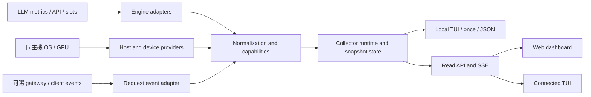

# 系統架構規劃

規劃日期：2026-10-02。2026-10-03 已實作 M1 的 config、adapters、providers、runtime、store、CLI、TUI、read API 與 Web。request events／remote agent／其他引擎仍是後續設計；實際命令見 [README](../README.md)，驗證見 [M1 紀錄](VALIDATION.md)。

## 1. 共用資料流

TUI 與 Web 同步規劃。backend 負責收集、正規化、rate 計算、去重與 freshness；展示端只負責篩選、格式化與呈現。



最初採用單一 collector process。若 TUI 與 Web 同時開啟，TUI 接入現有 backend snapshot，避免每個 UI session 各自輪詢引擎、重複計算與重複保存事件。

## 2. 模組邊界

| 模組 | 責任 | 輸入／輸出 |
| --- | --- | --- |
| `config` | 驗證 deployment inventory、環境變數引用、timeouts、scope | TOML → typed config；不執行任意 command |
| `core.models` | host／service／model／device／request／metric observation | 版本化 snapshot contract |
| `core.scheduler` | 控制收集週期、timeout、併發、取消與 backoff | 多來源 → 彼此隔離的取樣結果 |
| `core.normalize` | 單位轉換、counter epochs、rate、labels 去重、freshness | raw samples → observations |
| `adapters.engines` | 每種 backend 的端點與 metric semantics | engine API → 原始觀測與 capability report |
| `providers.host` | CPU、RAM、swap、process portable fields | local OS → host observations |
| `providers.device` | NVIDIA／Apple／未來其他 GPU provider | 同機裝置 → device observations |
| `adapters.requests` | 有權讀取的既有事件、去重、生命週期與匿名來源 | event／JSONL／callback output → request observations |
| `store` | 有上限的 snapshots、趨勢與請求 metadata | memory ring buffer＋查詢 |
| `tui`／`cli` | 終端操作、一次性輸出、JSON、診斷 | 讀 snapshot，不直接呼叫 backend engine |
| `api` | 讀取 snapshot／history／capabilities，推送 SSE | read-only HTTP contract |
| `web` | Web 總覽、圖表、詳細頁、重連與連線狀態 | API／SSE；不持有 engine keys |

Adapter 的共通契約為 identify、probe_capabilities、collect、normalize_metadata。失敗結果同樣是可呈現的資料，不讓 provider exception 終止所有來源。

## 3. Domain identity 與 capability model

host、service、model、device 是不同實體。service 可透過 gateway 暴露，metrics 卻位於另一個 engine URL；API 與 metrics 有各自認證設定。路由 model alias 與實際 served model 不保證一對一。

服務設定至少包括穩定 service id、host id、engine type、API URL、metrics URL／paths、label selection、啟用的來源，以及可選 engine version。GPU 使用 UUID／provider identity，process 使用 PID＋start time。沒有 mapping 證據時，只呈現主機／裝置資料。

Capability report 為每項欄位保留 supported／conditional／unsupported／unknown、取得方式、版本 profile、限制與理由。服務資料存在不代表其所有欄位存在；例如 Ollama loaded models 與 request usage 是兩條不同資料路徑。

## 4. 執行模式

| 模式 | 目前指令 | 行為 |
| --- | --- | --- |
| 本機 TUI | `llmtop tui --config llmtop.toml` | 同程序啟動 collector，不要求 Web server |
| Web 與共用 backend | `llmtop serve --config llmtop.toml` | 一個 collector＋API＋已建置 Web 靜態檔 |
| 連接既有 backend 的 TUI | `llmtop tui --connect http://127.0.0.1:8787` | 使用 API snapshot／events，不建立另一套 collector |
| 一次性輸出 | `llmtop once --json --config llmtop.toml` | counter rates 必須取兩個有效樣本；可提示 warming_up |
| 診斷 | `llmtop doctor --config llmtop.toml` | 僅檢查來源、能力與缺項；不送出生成請求 |

正式 console script 已註冊 `llmtop`，提供 `once`、`doctor`、`schema`、`serve`、`tui`。TUI 可獨立使用；與 Web 同時使用時以 `tui --connect` 讀取既有 backend，避免另啟 collector。

2026-10-04 增加裸指令 TUI、使用者設定／初始化、wheel 安裝／PATH 與 Web 啟動。官方版本檢查／更新待基礎版本與發佈來源完成後處理；見 [TODO](TODO.md)。

## 5. 收集與資料一致性

每個來源有獨立取樣狀態、deadline 與 freshness，不在 UI render callback 中做 I/O。HTTP client 共用連線池，限制同時輪詢數；慢來源 backoff，健康來源持續刷新。

sample 依相同來源 identity 建立 rate 基準；engine 重啟／series 變動／長 gap 時重置。一次收集完成後產生不可變 snapshot，含 sequence number 與各來源自己的 observed_at。不同主機不是同一時刻的原子讀取，畫面需保留時間差。

TUI 與 Web 讀取同一 snapshot sequence 時，所有數字、單位與品質狀態一致。Web API requests／SSE connections 不自行啟動新一輪 engine scrape。SSE reconnect 無可重播資料時，重新取得完整 snapshot。

部署 M1 先使用單 worker；多 worker 若各自持有 collector 將重複輪詢與分裂狀態。未來擴充時需把 collector ownership 與共享 store 明確拆開。

## 6. 平台與硬體策略

- CPU／RAM／swap／process 先使用 psutil portable API；Linux 特有 cgroup 欄位放在 Linux provider，macOS 特有 memory pressure 放在 Mac provider。
- NVIDIA 以 optional NVML binding 為優先，明確 timeout 的 nvidia-smi 作 fallback；不把 driver 缺失解釋為 GPU idle。
- Apple GPU provider 須獨立確認 API、權限與 OS 差異；預設不提升權限，沒有可靠來源即 N/A。Apple 統一記憶體不按獨立 VRAM 計算。
- remote engine endpoint 只能帶回引擎自己的資料；remote host 硬體需 exporter／agent，或明確顯示 unsupported。
- container／VM／host scope 都要保留，避免將 Docker Desktop Linux VM 的 RAM 當成實體 Mac RAM。

平台證據與降級方式見 [支援矩陣](SUPPORT-MATRIX.md)。

## 7. Web API 與請求事件的信任邊界

Web backend 預設 `127.0.0.1:8787`，API／UI 同 origin。來源 URL 由本機設定檔決定，UI 查詢只使用已登錄 id；不提供任意 scrape URL 輸入功能。engine／metrics 憑證由 backend 環境變數讀取，API snapshot 不包含秘密或原始認證 header。

跨主機 Web 存取需明確啟用，規劃使用認證與 TLS reverse proxy；bearer token 不放入 query string，瀏覽器 SSE 若採原生 EventSource，認證以同 origin session 或支援的 authenticated stream 方式處理。具體 API 草案見 [介面規劃](INTERFACES.md)。

request events 與一般 UI API 分開。M2 先採本機、明確授權的 JSONL 檔案，payload 採 allowlist。gateway plugin／callback 的安裝由使用者部署階段處理；LLMTOP 不預設介入推論流量或執行 Docker DB 查詢。

## 8. 未來專案結構（未建立）

```text
src/llmtop/
  cli.py
  config.py
  core/
  adapters/engines/
  adapters/requests/
  providers/host/
  providers/device/
  store/
  api/
  tui/
web/
  src/
  public/
schemas/
tests/
  fixtures/
  adapters/
  core/
  api/
  tui/
  web/
```

上圖為原規劃的模組分區；M1 實際目錄為 `src/llmtop/{adapters,providers,core}`、`frontend/src`、`tests` 與 `scripts`，另有 `api.py`、`tui.py`、`cli.py`。snapshot schema 由 `llmtop schema` 產生，packages、locks 與 CI 已建立；後續 events／agent 子系統尚未建立。

## 9. 設定草案與打包

設定範例見 [llmtop.example.toml](../examples/llmtop.example.toml)。它描述兩種介面、多種服務、分離的 API／metrics 認證、remote host 的硬體缺口，以及預設關閉的 request event source。介面的 enabled 表示允許啟用，由子命令決定啟動哪個展示層；serve 不會自行打開 TUI。

規劃 Python wheel／CLI 作主要安裝方式；Web 靜態產物由發佈建置打包，因此只使用已發佈 Web 的使用者不需 Node。前端開發需 Node 與套件管理器，實作時依官方 Vite 規格鎖定版本。Linux container 是後續發佈選項，Mac 原生 collector 不由 Linux container 取代。

技術依據：[FastAPI](https://fastapi.tiangolo.com/)、[React](https://react.dev/learn)、[Vite](https://vite.dev/guide/)、[SSE 使用方式](https://developer.mozilla.org/en-US/docs/Web/API/Server-sent_events/Using_server-sent_events)。
